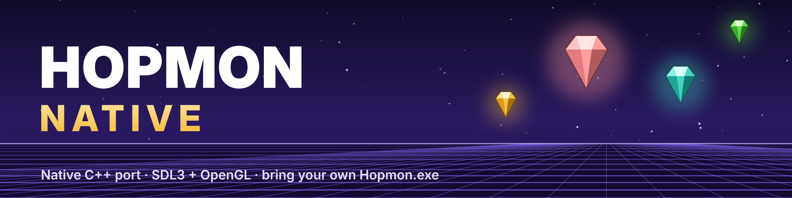

<p align="center"></p>

# Hopmon Native

An unofficial native C++ port of **Hopmon**, the 3D arcade puzzle game by Saito Games (2001–2009). It
runs on SDL3 and OpenGL 3.3 instead of DirectX 7, and adds modern display, input, audio and
quality-of-life options. With every option at its default, the game plays exactly like the original.

> **You need your own copy of the original game.** This repository contains no game content: no
> textures, models, levels, sounds, music or text. At startup the program reads everything from
> the original `Hopmon.exe` and its `Music01–04.mid` files. Without them it doesn't run.

## Requirements

- **Hopmon 2.0, the freeware build** from [saitogames.com](http://www.saitogames.com/).
  - Before starting, the program checks the SHA-256 of `Hopmon.exe` against this value:
    `6f4acb933e1692d97cc18819204c605287f72a71b9f62e1210ff8908be85930b`
  - Other builds are refused unless you start with `--allow-unverified`.
- **Windows 10/11** (x64) with an OpenGL 3.3 graphics driver. It also builds and runs on Linux and
  macOS; see [Building](#building).

## Download

Get the latest `HopmonNative-<version>-windows-x64.zip` from the
[Releases](../../releases) page. Each release lists its changes, and [CHANGELOG.md](CHANGELOG.md)
has the full history.

## Installing

1. Install or unzip the original Hopmon 2.0.
2. Unzip the release and put `HopmonNative.exe` in the same folder as `Hopmon.exe` and
   `Music01.mid`–`Music04.mid`. When updating, just replace the exe; your settings and progress
   are kept.
3. Run `HopmonNative.exe`.

The first launch creates two files next to the program: `hopmon_native.ini` (every option, with
comments) and `hopmon_native.log`. Saved progress uses the same registry key as the original
(`HKCU\Software\SaitoGames\Hopmon`), so unlocked levels carry over in both directions.

If the game is somewhere else, start with `--game "C:\path\to\Hopmon.exe"` or set `path =` under
`[game]` in the ini.

## Features

The original game logic runs unchanged, at its 100 steps per second. Everything below is optional.

**Display**
- Any resolution, as a window, borderless fullscreen or exclusive fullscreen, on any monitor.
- A true widescreen mode: the 3D view is widened, the menus stay 4:3, and the in-game HUD moves to
  the screen edges.
- Smooth motion at any refresh rate. The game logic stays at 100 Hz while frames are interpolated in
  between, with optional vsync and a frame cap.
- Antialiasing (MSAA), supersampling (render scale), anisotropic filtering, per-pixel lighting, soft
  shadows and smooth texture filtering.
- Adjustable HUD size and an in-level field of view.

**Pause / options menu (OPTIONS on the title screen; F10 or gamepad Start during a level)**
- The title screen's OPTIONS entry uses the original game's own artwork, which Saito Games drew but
  never used.
- Every setting can be changed in-game and is saved automatically: video, graphics, audio, controls
  and cheats.
- Resume, return to the main menu, quit, or reset all settings.
- Keyboard and gamepad rebinding.

**Audio**
- Separate master, sound-effect and music volumes.
- MIDI music through the Windows synth (as in the original) or any General MIDI SoundFont (`.sf2`).
- Optional **MP3/FLAC replacement music**. Put `Music01.mp3` (or `.flac`) and so on in a `music`
  folder next to `Hopmon.exe`, and it plays instead of the matching MIDI track. It loops seamlessly,
  and `LOOPSTART`/`LOOPLENGTH` tags are honoured.

**Controls**
- Full gamepad support through SDL3, with an adjustable stick dead zone.

**Cheats (off by default)**
- Unlock all levels, without touching your real saved progress.
- Infinite fire energy.
- No crystal slowdown.

[CONFIG.md](CONFIG.md) documents every setting and its allowed values.

## Controls

| Action | Keyboard | Gamepad |
|---|---|---|
| Move | Arrow keys | D-pad / left stick |
| Fire | Z or Shift | A / Cross |
| Camera (hold, then ←/→ rotate, ↑/↓ tilt) | X or Ctrl | B / Circle |
| Menu confirm | Enter, Z, X, Shift or Ctrl | A / B |
| Back / give up level | Esc | — |
| Pause (original) | P | — |
| Pause / options menu (in a level) | F10 | Start |
| Toggle fullscreen | Alt+Enter or F11 | — |
| Screenshot | F12 | — |

## Building

The project uses CMake (3.20 or newer) and C++17. If SDL3 isn't installed, CMake downloads SDL
`release-3.4.18` from GitHub and links it statically, so the result is a single self-contained
executable.

**Windows (Visual Studio 2022)**

```powershell
cmake -S . -B build -G "Visual Studio 17 2022" -A x64
cmake --build build --config Release
```

`build_windows.bat` runs these two commands for you. The result is `build\Release\HopmonNative.exe`.

**Making a release**

1. Set the new version in `CMakeLists.txt` (`project(HopmonNative VERSION x.y.z ...)`). It's the only
   place the version is set: the exe's version info, the log and the zip name all use it.
2. Add a section for it at the top of `CHANGELOG.md`.
3. Run `make_release.bat`. It builds the exe and creates `build\HopmonNative-x.y.z-windows-x64.zip`,
   containing the exe, README, CONFIG, CHANGELOG and license files.
4. Commit, tag `vx.y.z`, push, and publish a GitHub release with the zip attached and the changelog
   section as its notes.

**Linux / macOS**

```sh
cmake -S . -B build -DCMAKE_BUILD_TYPE=Release
cmake --build build -j
./build/HopmonNative --game /path/to/Hopmon.exe
```

On Linux and macOS, music needs a SoundFont: put `soundfont.sf2` next to the program or the game.

## How it works

- **The game itself.** The game logic was reconstructed by hand, function by function, from the
  original executable. It keeps the original constants, state machines, random-number generator and
  tick timing.
  - `src/game` holds the game's engine library and modules: title, level select, map, player,
    enemies, crystals, projectiles, particles and ending.
  - `src/framework` holds the parts of the DirectX 7 SDK sample framework the game was built on.
- **DirectX 7 replacement.** A small emulation layer replaces DirectX 7:
  - Direct3D fixed-function lighting, texture stages and blending become a GLSL shader.
  - DirectDraw blits become textured quads.
  - DirectSound becomes an SDL3 mixer, and DirectInput becomes SDL3 keyboard and gamepad input.
- **Assets.** These are read straight from the PE resources of `Hopmon.exe`, using `src/core`.

```
src/core       PE resource reader, SHA-256, asset loading, config, logging
src/gfx        OpenGL loader and the Direct3D 7 / DirectDraw emulation layer
src/audio      sound-effect mixer, MIDI sequencer, MP3/FLAC music streaming
src/input      SDL3 keyboard/gamepad -> DirectInput-style state
src/ui         pause/options menu overlay
src/framework  ported DirectX 7 SDK framework (d3dapp, d3dfile, d3dtextr, d3dutil)
src/game       the ported game logic
third_party    TinySoundFont, dr_mp3, dr_flac, font8x8 (see THIRD_PARTY_NOTICES.md)
res            program icon and version info for Windows
docs           README banner and the branding sources
```

## Differences from the original

- **Sprites at the screen edge.** DirectDraw dropped any sprite that crossed the screen edge. That
  hid the last fire-energy lights and the FPS digits. They're now clipped instead, so all of them
  show.
- **Sparkle effects.** Shot and hit sparkles now use their own random sequence. In the original they
  drew from the gameplay random-number generator on every rendered frame, which tied enemy behaviour
  to the frame rate.

## Command line

```
HopmonNative [--game PATH] [--windowed | --fullscreen] [--size W H] [--set section.key=value]
             [--allow-unverified]
```

`--set` overrides any ini setting for one launch, for example `--set video.aspect=2`.

## Legal

Hopmon, its name, artwork, levels, sounds and music are © 2001–2009 Saito Games. This project isn't
affiliated with or endorsed by Saito Games. It distributes none of the game's assets. You must
supply your own copy of the freeware game, available from [saitogames.com](http://www.saitogames.com/).

The code in `src/game` (and the ported DirectX SDK framework in `src/framework`) is a reconstruction
of the original program's logic, made so that the game can run on modern systems. It isn't covered
by this repository's license; see [LICENSE](LICENSE). Rights holders with concerns can open an
issue, and it will be addressed promptly.

See [LICENSE](LICENSE) and [THIRD_PARTY_NOTICES.md](THIRD_PARTY_NOTICES.md).
